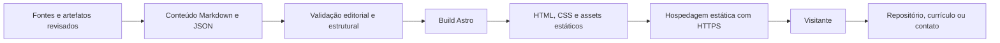

# Arquitetura proposta

> Plano original. A implementação foi adaptada para Node.js sem dependências após bloqueio de rede na instalação do Astro. Consulte o [registro atual](08-implementacao.md) e o README para executar o site.

Estado: **decisão de planejamento**, sem aplicação gerada nesta etapa.

## Escolha de stack

Proposta: **Astro + TypeScript + CSS com tokens**, com páginas estáticas, conteúdo Markdown/JSON versionado e scripts pequenos para interações. A arquitetura de ilhas do Astro permite manter o conteúdo como HTML e carregar interatividade separadamente. [Documentação oficial](https://docs.astro.build/en/concepts/islands/).

O projeto é principalmente editorial: apresentação, casos e contato. Um backend próprio, autenticação e banco de dados não ajudam esses fluxos iniciais. React pode ser adicionado a um componente isolado se a complexidade futura justificar; não é dependência inicial obrigatória.

| Alternativa | Vantagem | Custo neste contexto | Decisão |
| --- | --- | --- | --- |
| HTML/CSS/JS sem build | Muito simples e próximo da referência principal | Casos, tradução e templates podem acumular duplicação | Viável para página única; não selecionado para o conjunto de casos |
| Astro estático | Templates, geração de páginas e conteúdo no build | Ferramenta adicional e etapa de build | Selecionado |
| React/Vite SPA | Familiaridade de projetos anteriores e interações | Conteúdo editorial e rotas exigem decisões adicionais de renderização/SEO | Reservar React a necessidade concreta |
| Framework com SSR/backend | Dinamismo por requisição | Operação desnecessária para conteúdo versionado | Fora do escopo inicial |

Não fixar versões imaginadas de pacotes. Na implementação, confirmar versões estáveis compatíveis, requisitos de Node e APIs da versão escolhida; registrar no lockfile e na documentação de execução.

## Fluxo de dados



GitHub e LinkedIn são fontes para revisão editorial e destinos de links. A página pública não depende de chamadas autenticadas a essas plataformas. O currículo fica como arquivo estático revisado. Contato abre o cliente de e-mail; não há promessa de envio pelo servidor.

## Estrutura prevista

Esta árvore é uma especificação; as pastas de aplicação ainda não existem.

```text
src/
  components/
    Header.astro
    Hero.astro
    ProjectCard.astro
    EvidenceTrail.astro
    Experience.astro
    SkillGroup.astro
    Contact.astro
    Footer.astro
  layouts/
    BaseLayout.astro
    CaseLayout.astro
  pages/
    index.astro
    projetos/index.astro
    projetos/[slug].astro
    404.astro
    en/                         # somente na expansão bilíngue
  content/
    projects/                   # um Markdown por projeto/idioma
  data/
    profile.json
    experience.json
    skills.json
  content.config.ts             # ajustar à API da versão escolhida
  lib/
    urls.ts
    content.ts
  scripts/
    navigation.ts
    evidence-trail.ts
    contact.ts
  styles/
    tokens.css
    global.css
public/
  cv/                           # apenas o PDF público revisado
  images/projects/
  images/social/
  favicon.svg
docs/                           # documentação deste planejamento
tests/                          # verificações de comportamento relevantes
astro.config.mjs
package.json
package-lock.json
```

## Contrato de conteúdo

Os campos editoriais internos são retirados da página final. O mesmo projeto pode ter uma descrição no catálogo e um estudo de caso; o sistema não deve fabricar link para página ausente.

```ts
type Locale = 'pt-BR' | 'en';
type Area = 'produto' | 'requisitos' | 'dados' | 'software' | 'qualidade';

interface Evidence {
  label: string;
  url: string;
  kind: 'document' | 'code' | 'report' | 'demo' | 'test-run';
  observedAt: string; // data ISO da revisão
  verification: 'declared' | 'read' | 'executed';
}

interface Project {
  id: string;                    // estável entre idiomas
  locale: Locale;
  slug: string;
  title: string;
  summary: string;
  areas: Area[];
  context: 'portfolio' | 'academic' | 'professional';
  role: string;
  collaboration: 'individual' | 'team';
  technologies: string[];
  repositoryUrl: string;
  demoUrl?: string;
  image?: { src: string; alt: string; caption?: string };
  evidence: Evidence[];
  featured: boolean;
  order: number;
  hasCaseStudy: boolean;
  publication: 'draft' | 'ready';
  limitations: string[];
  sourceIds: string[];            // rastreabilidade interna
}
```

O corpo Markdown contém problema, contribuição, decisões e resultado. Métricas só entram com valor, unidade, denominador quando aplicável, período e fonte. Projetos `draft` não entram no build público. `demoUrl` ausente não gera botão desabilitado; a ação simplesmente não aparece. Screenshots ausentes podem usar esquema explicativo real, nunca imagem quebrada.

**Validações:** IDs/slug únicos por idioma; URL externa HTTP(S) em lista de domínios esperados; links internos existentes; casos destacados realmente gerados; datas válidas; campos de contribuição e limitações preenchidos; evidência `executed` exige registro da execução. Bloquear scripts ou HTML arbitrário no conteúdo.

## Rendering e interatividade

- O build gera todo o conteúdo essencial em HTML; o visitante pode ler os casos e usar links sem JavaScript.
- `EvidenceTrail` começa como seções com âncoras. Um script pode aprimorar a seleção, respeitando teclado e estados acessíveis, sem apagar a leitura estática antes de inicializar.
- Menu mobile e cópia de e-mail são scripts independentes. Se um falhar, não deve derrubar os demais.
- Imagens são locais e otimizadas; fonts locais com licenças. Ícones SVG individuais, sem carregar catálogo inteiro.
- Nada de feed de LinkedIn ou GitHub em tempo real no carregamento. Atualizações de conteúdo entram por commit.

## Rotas e internacionalização

PT-BR ocupa a raiz. A expansão EN usa `/en/`. As rotas de projeto podem ser localizadas, mas um `id` estável mapeia correspondências. Ao alternar idioma, ir ao mesmo caso quando houver; se faltar tradução, não oferecer link que leva a 404. Usar `lang`, canonical e `hreflang` coerentes apenas para páginas existentes. A documentação oficial descreve a opção de não prefixar o idioma padrão. [Astro i18n](https://docs.astro.build/en/guides/internationalization/).

## Hospedagem e entrega

Opção inicial recomendada: **GitHub Pages**, por combinar hospedagem estática com código público. Não há repositório deste site criado ou publicação realizada nesta etapa.

- Se o repositório for `caiotlad.github.io`, a base será a raiz.
- Se for um repositório de projeto, a base será o nome escolhido, por exemplo `/portfolio/`; esse nome ainda é uma proposta.
- Centralizar URLs em helper que considere `BASE_URL`, inclusive imagens, currículo e âncoras entre páginas.
- Configurar `site` para canonical/sitemap e conferir o caminho efetivo após implantação.
- Construir no GitHub Actions, testar antes do upload e publicar o artefato estático `dist/`.
- Em domínio próprio, revisar `site`, `base`, DNS e HTTPS antes de divulgar.

Essas diferenças de base estão documentadas no [guia oficial do Astro para Pages](https://docs.astro.build/en/guides/deploy/github/). A implantação futura deve usar a configuração válida na data da implementação. Sites ou outro host estático continuam alternativas se Caio preferir; não misturar dois fluxos de publicação na primeira versão.

## Pipeline previsto

```text
PR/commit
  → instalação pelo lockfile
  → validação do conteúdo e tipos
  → verificações de links internos e comportamentos críticos
  → build estático
  → inspeção visual e acessibilidade
  → publicação
  → smoke das URLs, currículo e assets no caminho real
```

Os comandos concretos serão definidos no `package.json` durante a implementação. A documentação desta etapa não implica que `npm run build` ou testes já existam. Para um projeto individual, branch principal e PRs curtos são suficientes; GitFlow completo não é necessário.

## Manutenção e segurança

Atualizar conteúdo mensalmente e após entrega relevante. Toda alegação nova precisa de uma fonte revisada. Revisar datas, disponibilidade, currículo e links antes de candidatura importante. Branch de conteúdo e publicação usam o mesmo pipeline.

Não incluir tokens, `.env` ou segredos no bundle. O site não exige chaves de APIs. Manter scripts próprios e dependências reduzidos, links externos com comportamento previsível e licenças dos assets registradas. Links que abrem nova aba devem avisar esse comportamento e usar `rel="noopener noreferrer"`.

O currículo original permanece como entrada de trabalho. Apenas uma cópia pública revisada entra em `public/cv/`. Não publicar a pasta `.work`, fontes privadas ou o registro interno de pendências por acidente.

## Registro de decisões

| ID | Decisão | Motivo | Reavaliar quando |
| --- | --- | --- | --- |
| ADR-01 | Geração estática com Astro | Conteúdo editorial, casos e manutenção previsível | Surgirem dados privados/dinâmicos por usuário |
| ADR-02 | Conteúdo local versionado | Rastreabilidade e independência de APIs | Edição por pessoas sem acesso ao repositório se tornar necessária |
| ADR-03 | PT-BR no lançamento | Entregar um conjunto completo e revisado | Traduções e currículo EN estiverem prontos |
| ADR-04 | Sem backend de contato | E-mail e LinkedIn atendem à necessidade | Formulário tiver demanda concreta e serviço de entrega definido |
| ADR-05 | SVG e efeitos leves | Identidade com baixo custo de execução | Um experimento 3D provar benefício sem prejudicar uso |
| ADR-06 | Hospedagem estática única | Operação simples e URLs previsíveis | Caio definir domínio ou plataforma diferente |
